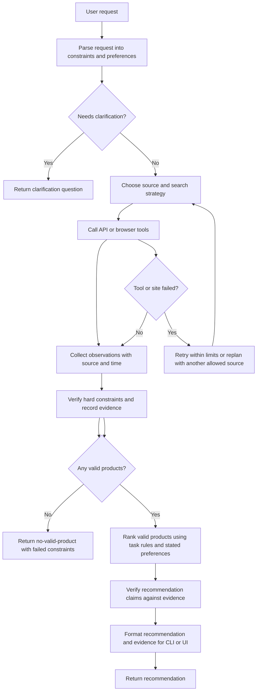

# Shopping agent implementation plan

## Recommendation

The end goal is an agent that can shop on real ecommerce websites by navigating them as a person would, because most sites will not give the project a private product API. The first milestone should still use a deterministic mock catalog and API. That gives us a known answer for testing parsing, constraints, and ranking before browser interaction adds another source of failures. Then the same tasks should be available through the mock storefront UI. The agent must pass those tasks using browser interaction before we try a small, permitted set of real sites.

Build the agent and evaluation harness in Python. Build the mock storefront as a separate app within this repository, with its own project structure. Start with a CLI for running tasks; generate a clean local results page for reviewing runs. The storefront itself is a web app for visual demos and browser evaluation. The mock API is an evaluation control surface, not an assumption that real retailers expose APIs.

## Project terminology

Use these terms consistently in code, task definitions, and papers:

- **Contract:** A typed definition of the data a module accepts and returns, including validation rules and failure cases.
- **Example:** A versioned product catalog, shopping request, or task definition used to seed a mock-store run. Prefer "example" or "task definition" over "fixture."
- **Tool:** A named action the agent can request, such as `search_site` or `get_listing_details`. The tool implementation performs the bounded operation and returns an observation.
- **Observation:** Data the tool actually saw, including source URL and time. Missing information stays unknown.
- **Evidence:** A stored link between a product claim and the observation that supports, contradicts, or cannot verify it.
- **Trial:** One agent/baseline run on one task definition with a known initial store state.
- **Harness:** The code that configures the agent, exposes its tools, enforces limits, records a trial, and passes the result to the evaluator.

Use `product example`, `request example`, and `task definition` in prose; keep filenames such as `data/products/` and `data/tasks/` descriptive. Use "tool call" for an agent-requested action and "tool result" for the returned observation. The evaluator knows expected outcomes; the agent does not.

## Proposed stack

- **Language:** Python 3.12 or the latest version supported by the team's dependencies.
- **Packaging and commands:** Use `requirements.txt` for a straightforward pip install and `run.py` as the default local launcher; it starts the mock API and storefront and opens the browser. Keep optional development dependencies in `requirements-dev.txt`.
- **Schemas:** Pydantic models for requests, products, tool inputs/outputs, tasks, and trial records. A sample schema is shown below.
- **Mock store:** A FastAPI backend and a small React/Vite storefront, kept in `mock-store/` with its own dependency files and commands. Begin with versioned JSON examples loaded into in-memory state, not a database.
- **Agent and model access:** Use the Anthropic API with Claude Haiku 5.5 for the initial agent. Keep the model behind a small provider interface and make model ID, prompts, and limits configurable for future comparisons.
- **Browser interaction:** Use Playwright's Python library directly for browser startup, navigation, screenshots, clicks, typing, scrolling, and page observations. Write our own agent loop and tool orchestration; do not use an existing full agent framework. The browser tool layer translates bounded agent actions into Playwright actions and returns observations.
- **Tests:** `pytest`, including unit tests for constraint and score logic, API tests for store behavior, and end-to-end tests for a few benchmark tasks.
- **Logging and results:** Structured JSONL trial records and ordinary Python logging. Record prompt/model versions and task/example versions so runs can be reproduced.

Pin dependencies and model identifiers for evaluation runs. The CLI runs the harness, while the mock storefront gives the team a visual demo and a browser-based benchmark target.

## Repository layout

```text
src/shopping_agent/
  cli.py
  schemas.py
  agent/
    planner.py
    executor.py
    verifier.py
    prompts/
  tools/
    catalog_api.py
    browser.py
    browser_actions.py
  eval/
    tasks/
    runner.py
    scoring.py
    report.py
tests/
data/
  products/
  tasks/
results/
mock-store/
  server/
    app.py
    examples/
    state.py
  storefront/
    package.json
    src/
  README.md
```

Keep the mock store as an independently runnable app inside the repository. Its backend owns versioned examples, deterministic state changes, and reset controls; its storefront uses the same backend. In the agent project, `tools` adapts either the mock API or browser actions to typed observations; `agent` plans, calls tools, and forms recommendations; `eval` runs controlled trials and grades them. API and browser tracks must use the same task and product examples wherever possible. API runs test decision logic; browser runs test whether the agent can find and verify the same facts through a user-facing site.

### Example data models

These are starting shapes, not a commitment to every field. Keep the user's original wording alongside parsed constraints so the evaluator can inspect what the parser inferred.

```python
class Constraint(BaseModel):
    attribute: str
    operator: Literal["eq", "gte", "lte", "contains"]
    value: str | float | bool
    hard: bool

class ShoppingRequest(BaseModel):
    original_text: str
    constraints: list[Constraint]
    preferences: list[str]
    clarification_needed: str | None = None

class Product(BaseModel):
    product_id: str
    title: str
    price: float | None
    currency: str
    in_stock: bool | None
    attributes: dict[str, str | float | bool]
    rating: float | None
    review_count: int | None
    source_url: str
    observed_at: datetime
```

Tool models should also capture action parameters and observations, for example `SearchInput(query, max_results)`, `ProductResults(items, page_url)`, and `BrowserObservation(url, title, visible_text, screenshot_path, actions_taken)`. Fields unavailable on a real site should be nullable or marked unknown, never filled in by guessing. A `TrialResult` records task/model/prompt versions, selected products, constraint checks, claims and evidence, tool calls, timing/cost, termination reason, and task success.

An `EvidenceItem` can contain `claim_id`, `product_id`, `field`, `claimed_value`, `observed_value`, `status` (`supports`, `contradicts`, or `unknown`), `source_url`, `observed_at`, and an optional screenshot or text excerpt reference. Store evidence as structured data, not prose embedded in the agent's final answer.

## Agent flow and responsibility split

The LLM should interpret ambiguous language and make preference tradeoffs. Code should own facts, constraints, state changes, and arithmetic. In particular, never let a model's claim that a product is in stock or under budget substitute for a lookup against the current store state.



1. Parse the request into a validated structure: hard constraints (such as maximum price, size, compatibility, and required features), soft preferences, quantities, and unresolved ambiguities. The agent can return a clarification response instead of searching when an ambiguity changes which products qualify. No separate "ask user" tool is needed for a one-turn CLI: the final response carries the question and the run terminates with `clarification_needed`. A future interactive UI can relay the question and resume the same session after the user answers.
2. The planner chooses a store/source and a search strategy. It may select among a fixed set of available sources, but it cannot invent a source or an attribute.
3. The executor calls a small allowlist of typed tools. API tools return structured product fields; browser tools return observations from the page. Limit result counts and observation size.
4. Deterministic code filters hard-constraint failures and computes comparable scores from the task's declared rules. The LLM may rank valid candidates using soft preferences and explain the tradeoff, but it cannot override a failed hard constraint.
5. The verifier re-fetches selected product details and current availability, checks every stated fact against returned fields, and rejects unsupported claims. If no product passes, report that rather than relaxing a hard constraint silently.
6. Return a short recommendation with product IDs, current price, reasons tied to verified evidence, unmet soft preferences, and sources. If no item satisfies every hard constraint, return `no_valid_product` with the failed constraints and optionally list near-matches separately, clearly marked as not satisfying the request.

Example final response:

> **No product meets every requirement.** I found two jackets under $100, but both lack the waterproof rating you asked for. I did not treat either as a match. If you want, I can search again without the waterproof requirement.
>
> Evidence: Jacket A, $79, listing does not state a waterproof rating. Jacket B, $94, listing says water-resistant, not waterproof. [View listings]

The agent should return recommendation text and structured claims, not format citations itself. After selecting a candidate, it calls `verify_claims(product_id, claims)` (or the equivalent verifier module) to produce `EvidenceItem` records from the observations already collected. The CLI or results page renders those records as readable citations with links to the source listing and, for browser trials, optional screenshots. The verifier must not invent evidence or treat an absent field as proof that a claim is false; it marks that claim `unknown`.

### Initial tool contract

Keep the agent responsible for deciding what information to seek and when it has enough evidence. Keep the tool responsible for executing one bounded action and reporting what it actually observed. This same boundary works for the API benchmark and for browser navigation on sites without APIs.

- API baseline tools: `search_catalog(query, max_results)`; `get_listing(product_id)`; `get_reviews(product_id, max_results)`; `validate_candidate(product_id, constraints)`; and `verify_claims(product_id, claims)`. `validate_candidate` applies deterministic hard-constraint checks and reports each pass, fail, or unknown with the field value and source. `verify_claims` returns structured evidence records linking each factual claim to an observation. Scoring code uses the task's explicit ranking rule (for example cheapest valid item or highest rating among valid items). It does not accept invented LLM preference weights. For open-ended preference tasks, the model can explain tradeoffs among valid products, but it must state its interpretation of preferences and must not override hard constraints.
- Browser navigation tools: `open_storefront(url)`; `inspect_page()`; `search_site(query)`; `click(target)`; `type_text(target, text)`; `scroll(direction, amount)`; `go_back()`; and `capture_screenshot()`. `search_site(query)` is a higher-level, deterministic action backed by a registered site adapter: it uses that site's tested search locator/interaction sequence to find the search field, enter the query, submit it, and return visible results. For unknown sites, fall back to general browser actions and let the agent inspect and operate the page. A visual-only task mode can expose screenshots and bounded coordinate clicks as a separate condition. Do not silently fall back to the mock API while scoring browser performance.
- Browser information tools: `extract_visible_products()` and `extract_listing_details()`. These return only fields visible on the current page, with the page URL and observation time. If a field is not shown, return unknown. Do not use hidden mock-store state or direct API calls during a browser-only trial.
- Optional mock checkout tool: `add_to_cart(product_id, quantity)` and `inspect_cart()`. This changes only the mock environment and supports objective task completion. Do not perform real purchases or payments.

For real sites, the agent chooses whether and what to search for. For a supported site, `search_site(query)` encapsulates the mechanics of locating the search control, entering the query, submitting it, and returning visible results; a tested site adapter can use selectors or interaction steps known to work on that site. The agent can then inspect results, open a listing with `click(target)`, and call `extract_listing_details()`. Validate each adapter manually and with smoke tests against the live site before using it in an evaluation, because site markup can change. If the adapter fails, return the failure observation and allow a bounded retry or general browser actions. Keep general browser tools available so the agent is not limited to sites with custom adapters.

All tools validate inputs, enforce action/result limits, return explicit errors, and include the page URL and observation time or example version. The agent does not write SQL, run shell commands, or access internal state directly. Add bounded retries only for transient browser/service errors; do not repeat invalid actions without replanning. After a site failure, report the failure or use a configured alternate source, and log which path it took.

## Mock shopping environment

Build a small mock storefront as its own app under `mock-store/`, rather than relying on a third-party simulator for the full benchmark. A useful reference to inspect is [Hydrogen's demo store](https://demostore.hydrogen.mock.shop/), which provides a clothing-store example. We can model the demo's basic shopping flow, but should create our own catalog and task instances so we control ground truth and meet the course requirement to author original benchmark tasks.

The mock catalog should include product IDs, titles, categories, structured attributes, prices, stock, sellers, review records/aggregates, and source metadata. Seed decoys and near matches: sponsored-looking top results, duplicate listings, keyword-stuffed titles, conflicting review quality, and products that miss exactly one hard constraint. Include controlled runtime events for price changes, stock changes, empty results, and a failed source.

Build the storefront UI as part of the mock-store project from the start, so it supports both visual demos and browser trials. The UI and API should read/write the same in-memory state seeded from versioned JSON examples. Provide a reset endpoint or runner hook to restore the example state and scheduled mutations before each trial. The API acts as evaluator setup/oracle and powers the API baseline; browser-only agent runs interact with the storefront UI and cannot call the API. Never connect mock checkout to a payment provider.

Storage options considered:

- **Versioned JSON examples plus in-memory state (recommended first):** simplest and easiest to reset exactly between trials; enough for a small fixed catalog. Save event logs/results to JSONL.
- **Convex:** offers a hosted reactive database and TypeScript-oriented workflow; useful if the team later needs shared live state, but adds cloud setup and makes fully isolated, repeatable trials harder.
- **SpacetimeDB:** combines application logic and database-style state; potentially useful for a more stateful multiplayer environment, but adds a platform-specific stack and is unnecessary for this benchmark's first version.
- **SQLite, PostgreSQL, or another SQL database:** mature and useful for larger catalogs, but adds schema/migration work. No SQL database is needed initially.

Start with JSON examples and in-memory state. Move to a database only if catalog size or concurrent sessions make the simpler store inadequate, and keep the reset interface stable so the choice can change later.

The first 10 benchmark tasks can follow the proposed 3 easy / 3 medium / 4 hard split, but make each task definition machine-readable and define its hard constraints, scoring rule, expected valid set, expected outcome, difficulty, and any state mutations. Include a no-valid-product task and a clarification task. Avoid assuming one exact answer when multiple products meet the objective; score against the valid set and declared ranking rule.

## Project sections and build order

### 1. Contracts and examples

Define Pydantic schemas, catalog fields, task format, scoring rules, and result format. Write several task definitions and manually review their expected valid sets before implementing the full agent. Version the examples.

### 2. Mock store

Build the independent `mock-store/` app: a FastAPI service, React/Vite storefront, versioned JSON product/task examples, in-memory catalog state, seed/reset controls, and scheduled price/stock mutations. Provide API endpoints for the API baseline and setup, while the UI supports browser-based trials. FastAPI is a good initial choice because the Python team can share Pydantic schemas and get request validation and interactive API docs. Flask is lighter and flexible but requires more choices for validation/docs; Starlette is lower-level and async-first but offers fewer batteries included. If the storefront backend becomes TypeScript-led, Express or Fastify are reasonable alternatives, but splitting the agent and store across languages may slow the first implementation. Choose FastAPI for the first version; do not add a database until the catalog exceeds the needs of in-memory state.

### 3. Deterministic tools and verifier

Implement the typed tool layer and hard-constraint verification first. Test boundary values, missing attributes, price changes, stock changes, empty search, malformed IDs, and unsupported claims. This gives the project a usable rules-based baseline early.

### 4. Agent and harness

Implement request parsing, planning, bounded tool execution, candidate comparison, verification, and final response generation. Set limits for tool calls, wall-clock time, and model tokens. Log each model request, tool input/output, retry, and termination reason, with secrets and unnecessary personal data excluded.

### 5. Evaluation and baselines

Implement rules-based, single-prompt LLM, standard ReAct, proposed agent, and the two planned ablations behind a shared evaluation runner. For each run, the runner loads a task and baseline configuration, resets the mock store to that task's initial example state, starts the selected agent with fixed limits, captures its tool calls and final response, asks the scorer to compare the result with the task's expected outcome, and appends one `TrialResult` record to JSONL. The runner should also mark termination when the agent completes, asks for clarification, reports no valid product, fails unrecoverably, or reaches its call/time limit. It should not decide what the agent does or share hidden expected answers with the agent.

Use the same task order, initial state, model where applicable, tool-call/time budget, and result schema. API baselines receive API tools; browser baselines receive browser tools. Compare agents within each condition rather than pretending these are identical tool interfaces. Keep prompt/configuration versions in every record. Produce aggregate and per-difficulty metrics, unsupported-claim audits, latency, calls, and cost. A run command might look like `shopping-eval run --tasks data/tasks --agent proposed --mode browser --repetitions 3 --output results/browser.jsonl`; `shopping-eval report results/browser.jsonl` can then generate summary tables and task-level failures.

The report command should also generate a local HTML results page, not only terminal tables. Include overall and per-difficulty success, constraint satisfaction, unsupported-claim rate, latency/cost, and filters for task, baseline, and run mode. Let a reviewer open a trial to inspect its final answer, evidence links/screenshots, tool-call trace, and failure/termination reason. Keep the source JSONL as the canonical data; make the page a read-only view generated from it.

### 6. Browser and real-site experiments

After API tasks pass, run those same tasks through the mock storefront using Playwright. First use accessible DOM observations and locators; then add a visual-only condition based on screenshots and clicks if time allows. Compare browser results with API results to locate failures in navigation, extraction, and reasoning separately. Browser interaction is a core project milestone, not an optional demo.

After the mock browser benchmark is stable, test one or two real ecommerce sites that permit the intended access, initially with read-only search and listing inspection. Do not scrape sites in ways that violate their terms or bypass access controls. Measure those runs separately from the controlled benchmark because listings, availability, and page structure change. Real-site shopping is the end goal; checkout/payment protocols remain out of scope until explicitly approved.

## Evaluation notes and guardrails

Store one JSONL record per trial, including task and example versions, baseline/configuration, trial number, selected products, constraints met, evidence items, tool calls, token usage, latency, cost, termination reason, and final cart-validation state. Use deterministic outcome checks for objective tasks. Audit recommendation claims by matching each product fact to its source observations; manually review a randomized subset because automated claim matching can miss paraphrases.

The proposed benchmark has only 10 tasks and three runs per configuration. That is useful for an initial pilot, but it is too small to support a confident claim of statistical significance or stable estimates of rare unsupported claims. Treat the first results as exploratory. Before claiming a 15 percentage-point improvement, increase the number and diversity of tasks and repeated runs, predefine the statistical test and confidence interval, and report task-level results as well as aggregates. Do not change success thresholds after seeing the results.

Do not log API keys. Keep credentials in environment variables, and make a full benchmark run possible against a mock model/provider for tests that do not need an external API.

## Initial milestones

1. **Foundation:** Agree on contracts, terminology, and scoring rules; create versioned product/task examples and the resettable mock store.
2. **Baseline:** Implement deterministic tools, verifier, and rules-based benchmark runner.
3. **Agent:** Add the Anthropic/Claude Haiku 5.5 request parser and planner, bounded API tool loop, verifier, recommendation output, and standard ReAct baseline.
4. **API evaluation:** Add remaining baselines and ablations, run the API task suite, and inspect per-task failures.
5. **Browser evaluation:** Add Playwright browser tools and run the same tasks through the mock storefront. Confirm no API shortcuts are used in this condition.
6. **Real-site exploration:** Implement and smoke-test site adapters on permitted real sites before relying on them. Test read-only navigation, log failures separately, and investigate self-healing site tools or purchase protocols after the core benchmark is reproducible.
